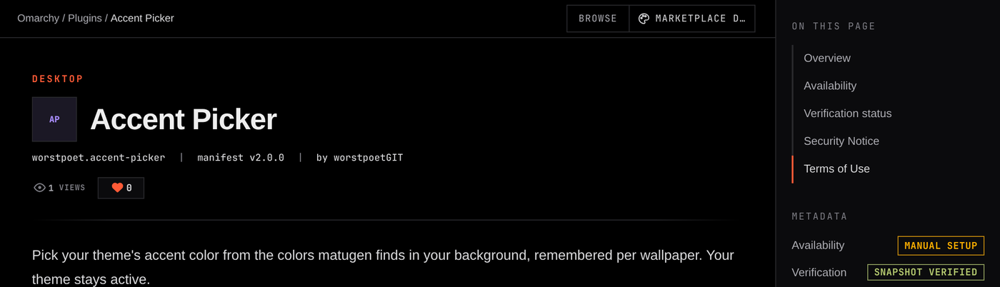
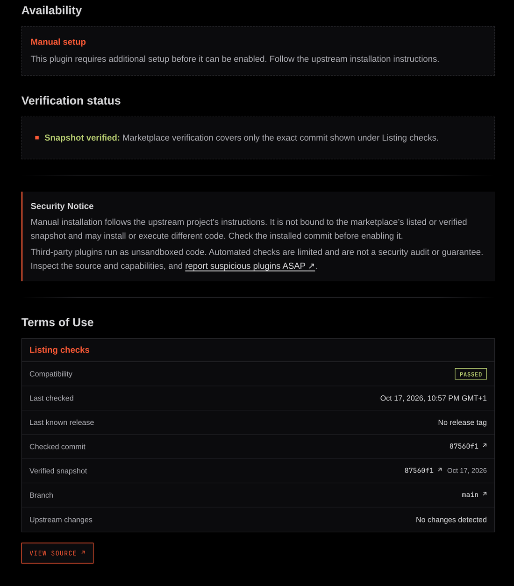

# Accent Picker

An Omarchy bar widget that sets your theme's accent color from your background.

**Listed on the Omarchy Plugin Marketplace:** [plugins.omarchy.org › Accent Picker](https://plugins.omarchy.org/plugin.html?id=worstpoet.accent-picker)



[matugen](https://github.com/InioX/matugen) finds up to four source colors in an image. Accent Picker shows them in a popup next to your theme's own accent, and the one you click becomes the accent of the theme you're using. Nothing else about the theme changes, and it stays your active theme.

The pick is remembered per background. When you change wallpapers, the accent follows: it uses whatever color you picked for that wallpaper last time, or its most dominant color if you never picked one.

## Requirements

- Omarchy with the Quickshell shell (Quattro)
- matugen, from the Arch `extra` repository
- A still-image background (video backgrounds are skipped)

## Install

```bash
omarchy plugin add https://github.com/worstpoetGIT/accent-picker.git --enable
```

Or find it on the [marketplace page](https://plugins.omarchy.org/plugin.html?id=worstpoet.accent-picker), which shows the commit that passed the marketplace's checks:



The palette icon appears on the right side of the bar. Move it with `omarchy bar move worstpoet.accent-picker --section <left|centerBegin|centerEnd|right>`.

## Use

Click the icon, then click a color, or use the arrow keys and Enter. **Theme default** puts the theme's own accent back. The first open on a new background takes a second or two while matugen reads the image; after that it's cached.

Each theme keeps its own pick, so switching themes shows that theme's accent, picked or not.

## Settings

Set from **Setup › Plugins** or `omarchy bar set`:

| Setting | Default | What it does |
|---|---|---|
| Follow background changes | On | When an accent is picked, update it when the background changes |

## What it changes on disk

Only when you click a color, and only for the current theme:

- It writes `~/.config/omarchy/themes/<theme>/colors.toml`, Omarchy's normal per-theme override file. The file is the theme's own `colors.toml` with the `accent` line changed, and a comment at the top saying the plugin wrote it. Omarchy layers that folder over the theme when it applies it.
- If you already had your own `colors.toml` there, it's backed up first, and the accent is changed inside your colors.
- Then it reapplies the same theme with `omarchy-theme-set`, keeping your background.

**Theme default** undoes all of this: it deletes the file the plugin wrote (or restores your backup) and reapplies the theme. Themes installed from git are left alone, since changing their files would conflict with `omarchy theme update`.

Plugin state lives in `~/.local/state/omarchy-accent-picker/` (picks per background, backups) and `~/.cache/omarchy-accent-picker/` (palette cache).

## Uninstall

Choose **Theme default** on each theme you picked an accent for, then:

```bash
omarchy plugin remove worstpoet.accent-picker
```

You can then delete `~/.local/state/omarchy-accent-picker` and `~/.cache/omarchy-accent-picker`.

## License

MIT
