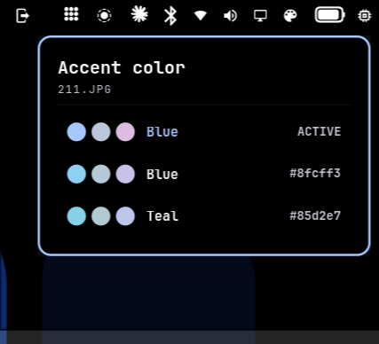

# Accent Picker

An Omarchy bar widget that themes the desktop from your background.



[matugen](https://github.com/InioX/matugen) finds up to four source colors in an image, but normally only the most dominant one is used. Accent Picker shows all of them in a popup, and the one you click becomes an Omarchy theme: the bar, borders, terminals, btop, editors and everything else Omarchy themes follow it. Your background stays where it is.

The choice is remembered per background. Switch wallpapers and the desktop re-themes with whatever color you picked for that wallpaper last time (or its most dominant color if you never picked one).

## Requirements

- Omarchy with the Quickshell shell (Quattro)
- matugen: `sudo pacman -S matugen`
- A still-image background (video backgrounds are skipped)

## Install

```bash
omarchy plugin add https://github.com/worstpoetGIT/accent-picker.git --enable
```

The palette icon appears on the right side of the bar. Move it with `omarchy bar move worstpoet.accent-picker --section <left|centerBegin|centerEnd|right>`.

## Use

Click the icon, then click a color, or use the arrow keys and Enter. The first open on a new background takes a second or two while matugen reads the image; after that it's cached.

Picking a color switches you to a theme named `accent-picker`. To go back to a regular theme, pick one from the theme switcher as usual; your accent choices stay saved for next time.

## Settings

Set from **Setup › Plugins** or `omarchy bar set`:

| Setting | Default | What it does |
|---|---|---|
| Theme mode | Dark | Build a dark or light theme from the color |
| Follow background changes | On | While `accent-picker` is the active theme, re-theme when the background changes |

## How it works

- `Panel.qml`: the bar button and popup.
- `accent.py`: runs matugen on the current background (`~/.local/state/omarchy/current/background`), writes `~/.config/omarchy/themes/accent-picker/colors.toml` from the Material You roles, and runs `omarchy-theme-set accent-picker` with `OMARCHY_THEME_SKIP_BACKGROUND=1`. Omarchy's own templates generate every app's config from that `colors.toml`.
- Named terminal colors (red, green, …) are generated at fixed hues, nudged slightly toward the accent, at a lightness that reads on the background.

State lives in `~/.local/state/omarchy-accent-picker/` (choices per background) and `~/.cache/omarchy-accent-picker/` (palette cache).

## Uninstall

```bash
omarchy plugin remove worstpoet.accent-picker
rm -rf ~/.config/omarchy/themes/accent-picker ~/.local/state/omarchy-accent-picker ~/.cache/omarchy-accent-picker
```

Switch to another theme first if `accent-picker` is active.

## License

MIT
